# 智慧图书馆系统 Smart Library System


简体中文 | [English](README_EN.md)

## 项目简介

智慧图书馆系统是一套面向高校图书馆场景的前后端分离全栈应用。系统把「馆藏怎么找、座位怎么占、人在哪一层」这三件在真实图书馆里最耗时间的事，收敛到同一个 Web 界面里完成：读者可以检索馆藏、在线借阅与续借、用可视化座位图预约研习座位、按楼层平面图导航到书架位置，并在个人学习中心记录阅读时长与笔记；管理员在独立的控制台里维护图书、审核归还申请、管理读者与违规记录。

系统的工程重点放在资源状态的实时一致性上。座位有「空闲 / 使用中 / 暂离」三种状态，由后端定时任务按分钟级别巡检：预约后 15 分钟未签到、或临时离开超过 15 分钟，座位自动回收并计入违规；同一读者累计 3 次违规后禁用预约权限 7 天。借阅侧同样是一个完整闭环：读者提交归还申请后图书进入待审核状态，管理员确认后库存才真正回滚，避免库存与实际在架数量脱节。

安全方面，密码以 BCrypt 哈希存储且不可逆，登录令牌使用 JWT 签发并在拦截器中完成鉴权，角色取自数据库 `role` 列而非前端传参，前端路由守卫与后端接口校验各做一次判断。数据库连接、JWT 密钥、跨域白名单全部外置为环境变量，配置文件中只保留本地开发默认值，部署时无需改动任何代码。

项目同时支持两种运行形态。**演示形态**使用 H2 文件数据库并开启 MySQL 兼容模式，不装 MySQL 也能一键跑起来，适合课堂演示、评审现场和局域网小范围试用；**生产形态**切换到 MySQL 8，配合 Nginx、Docker 或 systemd 部署。仓库内提供的 Windows 一键脚本会自动完成 Java 检测、缺失时打包、密钥生成、双端启动与局域网地址打印。

## 技术栈

| 层次 | 技术选型 | 版本 | 用途 |
|---|---|---|---|
| 前端框架 | Vue | 3.5 | 组合式 API 与单文件组件 |
| 开发语言 | TypeScript | 6.0 | 全量类型约束 |
| 构建工具 | Vite | 8.0 | 开发服务器与生产构建 |
| UI 组件 | Element Plus + @element-plus/icons-vue | 2.14 / 2.3 | 表单、表格、弹窗等基础组件 |
| 后台模板 | Tabler Core | 1.7 | 页面骨架与视觉规范（经 CSS 桥接层接入） |
| 状态管理 | Pinia | 3.0 | 用户会话与全局状态 |
| 路由 | Vue Router | 4.6 | 路由守卫与角色级页面准入 |
| 网络请求 | Axios | 1.17 | 请求封装、拦截器与错误统一处理 |
| 数据可视化 | ECharts | 5.6 | 借阅趋势、月度阅读报告 |
| 交互图形 | 原生 SVG | — | 楼层平面图、座位图 |
| 样式预处理 | Sass (sass-embedded) | 1.100 | 主题变量与嵌套样式 |
| 后端框架 | Spring Boot | 3.2.0 | Web 层、任务调度、参数校验 |
| 运行环境 | Java (JDK) | 17 | 后端运行时 |
| 持久层 | MyBatis-Plus | 3.5.5 | 通用 CRUD、分页与逻辑删除 |
| 身份认证 | java-jwt (Auth0) | 4.4.0 | 令牌签发与解析 |
| 密码加密 | spring-security-crypto | 随 Boot 管理 | BCrypt 哈希，不引入完整过滤链 |
| 参数校验 | spring-boot-starter-validation | 随 Boot 管理 | 请求体约束校验 |
| 定时任务 | Spring Scheduling | 随 Boot 管理 | 座位与预约状态巡检 |
| 简化代码 | Lombok | 随 Boot 管理 | 实体类样板代码消除 |
| 数据库（生产） | MySQL | 8.0 | 主数据库，utf8mb4 |
| 数据库（演示） | H2 Database | 随 Boot 管理 | 文件型数据库，MySQL 兼容模式 |
| 部署 | Nginx / Docker / Docker Compose / systemd | — | 静态资源托管与容器编排 |

依赖的具体小版本以 `smart-library-frontend/package.json` 与 `smart-library-backend/pom.xml` 为准。

## 环境配置

### 硬件与系统

| 项目 | 要求 |
|---|---|
| 操作系统 | Windows 10/11、macOS、Linux 均可 |
| 内存 | 建议 4 GB 以上（前端构建阶段占用较高） |
| 磁盘 | 演示形态约 300 MB，生产形态另需 MySQL 数据空间 |

### 软件依赖

| 软件 | 最低版本 | 说明 |
|---|---|---|
| JDK | 17 | 后端编译与运行，`java -version` 可验证 |
| Node.js | 20.19 或 22.12 以上 | 受 Vite 8 的 `engines` 约束，Node 18 无法启动 |
| npm | 随 Node 附带 | 安装前端依赖 |
| Maven | 3.8 | 后端构建；也可用 IDEA 内置 Maven |
| MySQL | 8.0 | 仅生产形态需要，演示形态可跳过 |
| Docker | 24 以上 | 仅容器化部署需要 |

### 端口占用

| 端口 | 服务 | 说明 |
|---|---|---|
| 3000 | 前端开发服务器 | `vite.config.ts` 中固定为 3000，并监听 `0.0.0.0` |
| 8080 | 后端接口服务 | 前端通过 `/api` 前缀代理到该端口 |
| 3306 | MySQL | 生产形态使用 |
| 5173 / 80 | Docker 前端映射 | `docker-compose.yml` 将容器 80 映射到宿主机 5173 |

## 本地运行

### 方式一：一键脚本（Windows，零配置）

适合第一次接触本项目、只想把系统跑起来看看的场景。后端走 H2 演示库，不需要 MySQL。

| 文件 | 作用 |
|---|---|
| `start-library.bat` | 启动后端与前端，并打印本机地址和局域网地址 |
| `stop-library.bat` | 停止服务，释放 3000 与 8080 端口 |
| `allow-firewall.bat` | 放行防火墙 3000/8080 端口，手机打不开时使用，需管理员授权 |
| `update-github.bat` | 提交并推送本地改动到 GitHub |

双击 `start-library.bat` 后，脚本依次执行：检测 Java 环境 → 缺少 jar 时调用 Maven 打包 → 首次运行生成随机 `JWT_SECRET` 并写入 `.local\jwt-secret.txt` 长期复用 → 以 `demo` 配置后台启动后端 → 安装前端依赖并启动开发服务器 → 输出访问地址。运行日志写入 `logs\` 目录。

启动完成后访问 `http://localhost:3000`。同一个 WiFi 下的手机或其他电脑访问脚本打印的局域网地址即可，例如 `http://192.168.1.10:3000`。

启动成功后会显示内置管理员账号 `admin` / `admin`，建议首次登录后立即到个人中心修改密码。`.local\jwt-secret.txt` 是机密文件，不要提交到仓库或外发；删除它会使所有已签发的令牌失效，下次启动会重新生成。

### 方式二：手动启动（开发调试）

**第一步：准备数据库**

演示形态无需任何操作，后端会自动在 `smart-library-backend/data/` 下创建 H2 文件库并执行 `db/schema-h2.sql`。

生产形态使用 MySQL：

```bash
# 在仓库根目录执行，脚本会自动建库建表
mysql -u root -p < smart-library-backend/src/main/resources/db/schema.sql
```

`schema.sql` 开头包含 `DROP TABLE IF EXISTS`，重复执行会清空已有数据，仅在初始化或重置环境时使用。

**第二步：启动后端**

```bash
cd smart-library-backend

# 演示形态：H2 文件数据库，无需 MySQL
mvn spring-boot:run -Dspring-boot.run.profiles=demo

# 生产形态：读取 MySQL 配置
mvn spring-boot:run

# 或者先打包再运行
mvn clean package -DskipTests
java -jar target/smart-library-backend-1.0.0.jar --spring.profiles.active=demo
```

后端启动在 `http://localhost:8080`。演示形态还可访问 `http://localhost:8080/h2-console` 查看数据库，JDBC URL 为 `jdbc:h2:file:./data/smart_library`，用户名为 `sa`，密码为空。

**第三步：启动前端**

```bash
cd smart-library-frontend
npm install
npm run dev
```

开发服务器启动在 `http://localhost:3000`，Vite 已将 `/api` 代理到 `http://localhost:8080`，因此前端代码中的请求前缀统一写 `/api`。

生产构建：

```bash
npm run build      # 产物输出到 dist/
npm run preview    # 本地预览构建结果
```

**第四步：登录**

浏览器打开 `http://localhost:3000`，使用 `admin` / `admin` 进入管理后台；读者账号在登录页自行注册，账号需为 11 位学号。

### 方式三：Docker Compose

```bash
docker compose up -d --build
```

该配置会启动三个容器：MySQL 8.0（自动执行 `schema.sql` 初始化）、Spring Boot 后端（8080）、Nginx 托管的前端（宿主机 5173）。访问 `http://localhost:5173`。

容器编排的细节与阿里云部署步骤见 [DOCKER_GUIDE.md](DOCKER_GUIDE.md) 与 [deploy/DEPLOY_ALIYUN.md](deploy/DEPLOY_ALIYUN.md)。

## 环境变量

数据库连接、令牌密钥与跨域白名单均已外置。不设置环境变量时使用括号内的默认值，本地开发无需任何配置；部署时只需注入变量，不必修改配置文件。

| 变量 | 用途 | 默认值 |
|---|---|---|
| `DB_URL` | MySQL 连接串 | `jdbc:mysql://localhost:3306/smart_library?...` |
| `DB_USERNAME` | 数据库用户名 | `root` |
| `DB_PASSWORD` | 数据库密码 | `root` |
| `JWT_SECRET` | 令牌签名密钥，上线必须替换 | `smart-library-secret-key-2024-very-long-and-secure` |
| `JWT_EXPIRATION` | 令牌有效期，单位毫秒 | `86400000`（24 小时） |
| `CORS_ALLOWED_ORIGINS` | 允许跨域的前端地址，多个用逗号分隔 | `*` |

```powershell
# Windows PowerShell
$env:DB_PASSWORD = "真实数据库密码"
$env:JWT_SECRET  = "一段足够长的随机字符串"
java -jar target/smart-library-backend-1.0.0.jar
```

```bash
# Linux / macOS
export DB_PASSWORD="真实数据库密码"
export JWT_SECRET="一段足够长的随机字符串"
java -jar target/smart-library-backend-1.0.0.jar
```

更换 `JWT_SECRET` 会使此前签发的所有令牌立即失效，全部用户需重新登录。

## 核心功能

### 读者端

| 模块 | 能力 |
|---|---|
| 数据概览 | 在借数量、到期提醒、累计阅读时长、常用入口聚合 |
| 图书检索 | 按书名、作者、ISBN、分类多条件检索，支持分页与库存状态展示 |
| 图书详情 | 馆藏位置、简介、库存与借阅热度，可收藏、可借阅、可写笔记 |
| 借阅管理 | 借阅、续借、提交归还申请，查看借期与到期倒计时 |
| 座位预约 | SVG 座位图实时着色，点击座位完成预约、签到、暂离、结束使用 |
| 室内导航 | 楼层平面图与书架点位标注，按起点终点生成行走路线 |
| 书单广场 | 浏览主题书单、点赞、将整份书单加入待读 |
| 学习中心 | 阅读打卡、阅读记录统计、笔记管理、月度阅读报告 |

### 管理端

| 模块 | 能力 |
|---|---|
| 管理后台 | 馆藏总量、在借数量、读者规模、预约活跃度的汇总视图 |
| 图书维护 | 新增与编辑图书、维护总册数与在架册数 |
| 借阅管理 | 审核读者提交的归还申请，核对逾期记录并发送归还提醒 |
| 读者管理 | 读者列表、违规次数与预约禁用状态查看 |

### 业务规则

借阅侧限制为每人同时最多借阅 5 本不同图书，同一本书不可重复借阅；单次借期可在 12 小时至 720 小时之间选择，默认 30 天；每本书仅可续借一次，续借延长 30 天；归还申请提交后需管理员确认，库存才回滚。

座位侧的三种状态由后端每分钟巡检：预约后 15 分钟内未签到、或临时离开超过 15 分钟，座位自动释放并计入一次违规；同一读者累计 3 次违规后，预约权限禁用 7 天。

### 权限模型

系统只保留两种角色，`ADMIN` 与 `USER`，角色值存储在 `sys_user.role` 列中，登录时随令牌返回。前端路由守卫按 `adminOnly` 与 `studentOnly` 元信息拦截跳转，后端 `JwtInterceptor` 再次校验并把 `userId` 与 `role` 写入请求属性，接口内部据此裁剪数据范围。管理员与读者的功能集互斥，管理员不提供借书与续借能力。

## 界面截图

截图文件统一放在 `docs/screenshots/` 目录，按下表命名，下方按编号依次展示。演示数据来自 `admin` 管理员账号与一个读者账号，浏览器宽度 1440 px、滚动到页面顶部截取。

| 编号 | 界面 | 路由 | 文件 |
|---|---|---|---|
| 01 | 登录页 | `/login` | `docs/screenshots/01-login.png` |
| 02 | 学生数据概览 | `/dashboard` | `docs/screenshots/02-dashboard.png` |
| 03 | 图书检索 | `/books` | `docs/screenshots/03-books.png` |
| 04 | 图书详情 | `/books/:id` | `docs/screenshots/04-book-detail.png` |
| 05 | 借阅管理 | `/borrow` | `docs/screenshots/05-borrow.png` |
| 06 | 座位预约 | `/seats` | `docs/screenshots/06-seats.png` |
| 07 | 室内导航 | `/navigation` | `docs/screenshots/07-navigation.png` |
| 08 | 书单广场 | `/book-lists` | `docs/screenshots/08-book-lists.png` |
| 09 | 学习中心 | `/study-center` | `docs/screenshots/09-study-center.png` |
| 10 | 管理后台 | `/admin` | `docs/screenshots/10-admin-dashboard.png` |
| 11 | 读者管理 | `/users` | `docs/screenshots/11-users.png` |

### 01 登录页

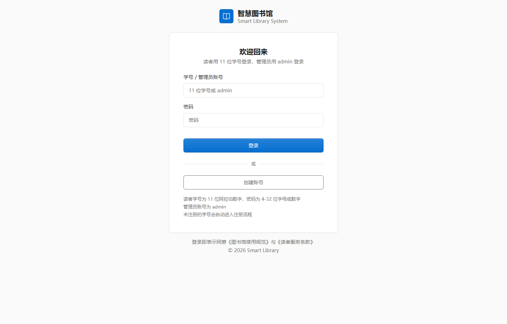

### 02 学生数据概览

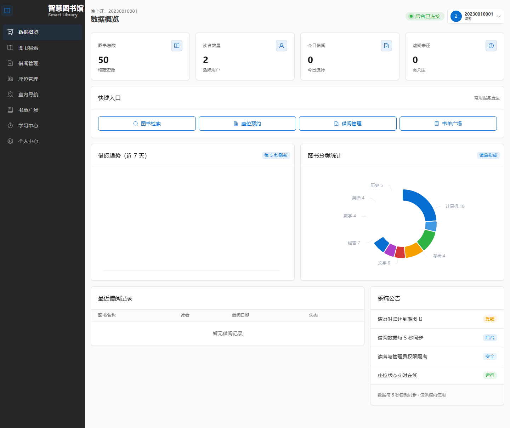

### 03 图书检索

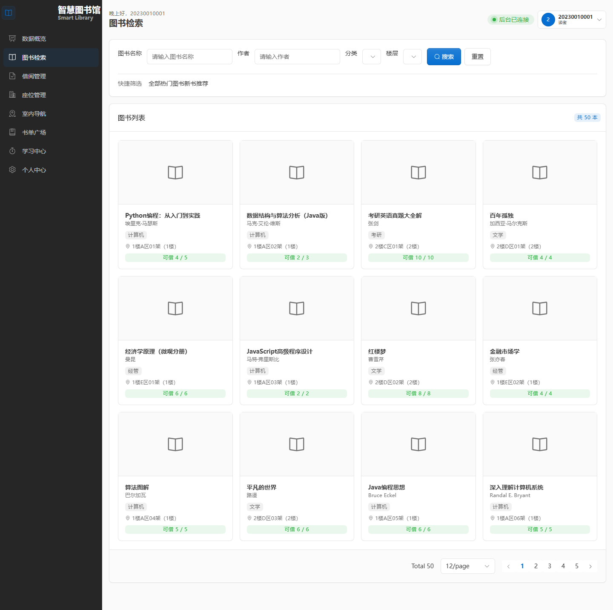

### 04 图书详情

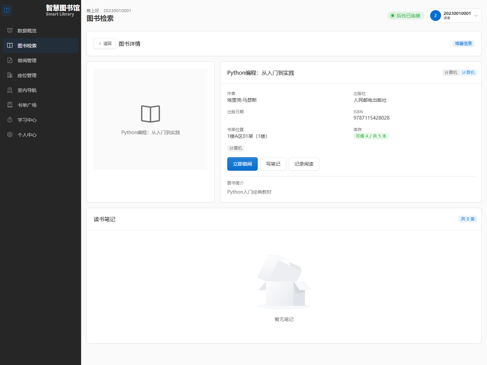

### 05 借阅管理

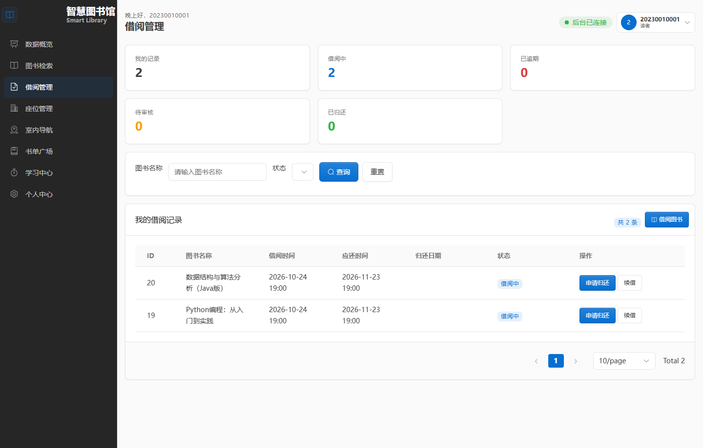

### 06 座位预约

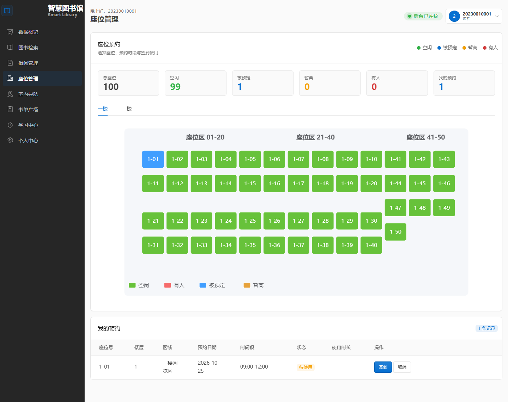

### 07 室内导航

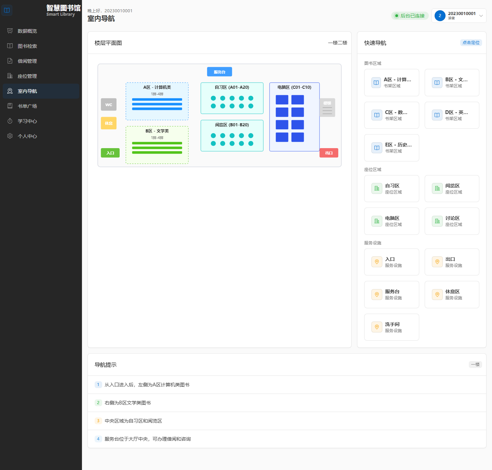

### 08 书单广场

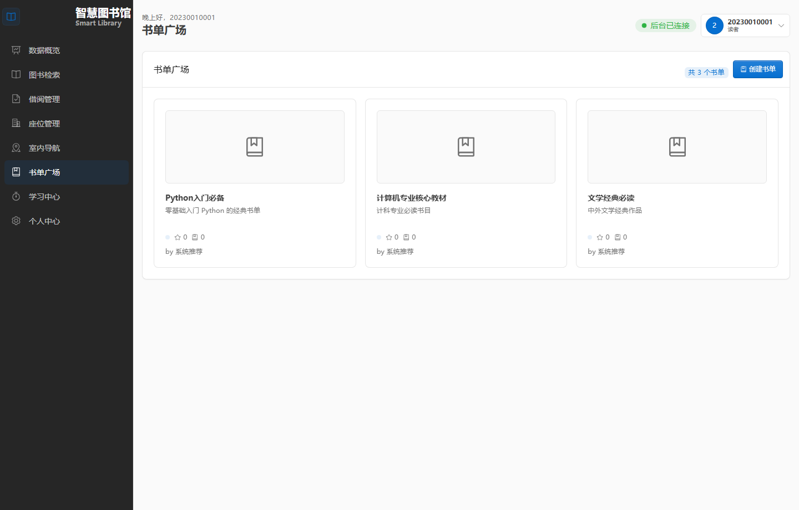

### 09 学习中心

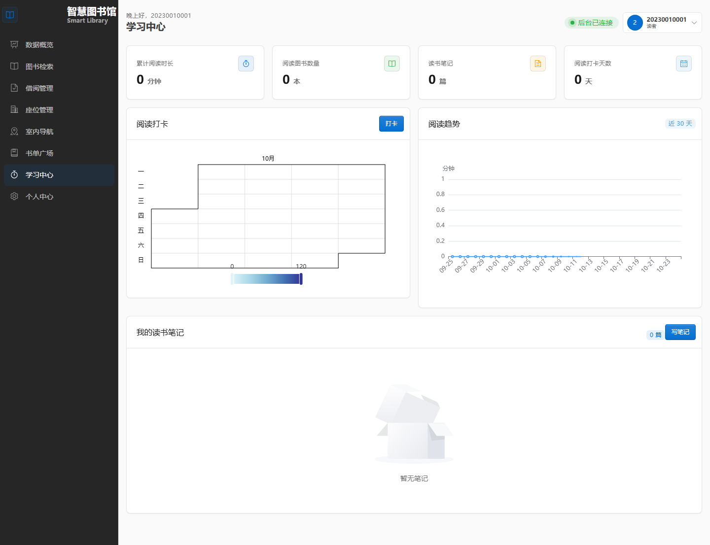

### 10 管理后台

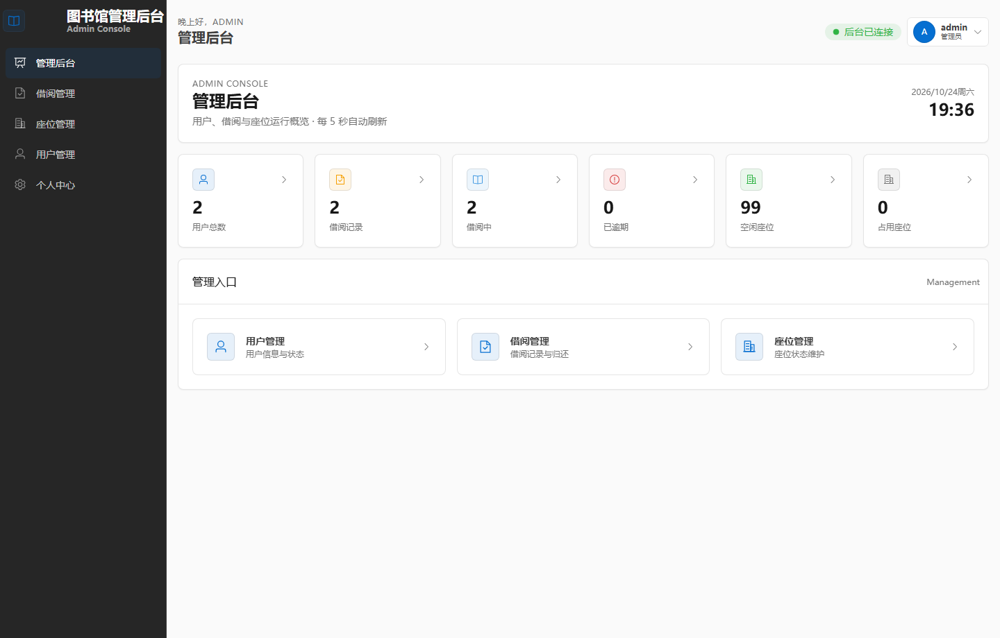

### 11 读者管理

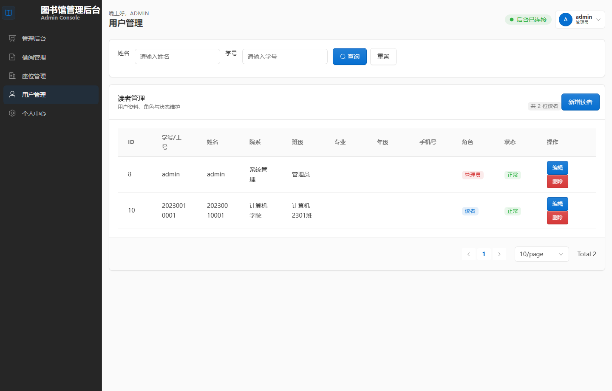

以上截图均以 1440 px 浏览器宽度、已登录状态下截取，隐藏书签栏，演示数据来自本地 H2 演示库。

## 项目结构

```
smart-library/
├── smart-library-frontend/          前端工程
│   ├── src/
│   │   ├── api/                    接口封装，按业务域拆分
│   │   ├── components/             SVG 座位图、楼层图、滚轮选择器、月度报告
│   │   ├── constants/              角色判定常量
│   │   ├── mock/                   本地 Mock 适配器
│   │   ├── router/                 路由表与角色守卫
│   │   ├── store/                  Pinia 用户会话
│   │   ├── styles/                 Tabler 与 Element Plus 的样式桥接
│   │   ├── utils/                  请求封装、实时轮询
│   │   └── views/                  页面视图，共 14 个
│   ├── vite.config.ts              端口、代理、分包策略
│   └── package.json
├── smart-library-backend/           后端工程
│   ├── src/main/java/com/smartlibrary/
│   │   ├── config/                 跨域、MyBatis-Plus、密码编码、定时任务、数据迁移
│   │   ├── controller/             11 个 REST 控制器
│   │   ├── dto/                    请求与响应对象
│   │   ├── entity/                 11 个实体类
│   │   ├── exception/              业务异常与全局处理器
│   │   ├── interceptor/            JWT 拦截器
│   │   ├── job/                    预约与暂离超时巡检
│   │   ├── mapper/                 MyBatis-Plus Mapper
│   │   ├── service/                业务逻辑
│   │   └── utils/                  令牌工具
│   └── src/main/resources/
│       ├── db/schema.sql           MySQL 建表脚本
│       ├── db/schema-h2.sql        H2 建表脚本
│       ├── application.yml         生产配置
│       └── application-demo.yml    演示配置
├── deploy/                          阿里云部署说明、Nginx 配置、systemd 单元
├── docs/screenshots/                界面截图
├── scripts/                         演示与数据清理脚本
├── docker-compose.yml               三容器编排
├── start-library.bat                一键启动
├── stop-library.bat                 一键停止
├── allow-firewall.bat               防火墙放行
└── update-github.bat                代码推送
```

## 常见问题

**后端启动报 `Communications link failure`**

MySQL 未启动或连接参数不对。先确认 MySQL 服务在运行，再核对 `DB_URL` 与账号密码。只想先跑起来的话，改用 `--spring.profiles.active=demo` 走 H2，不需要 MySQL。

**前端登录报 `Network Error`**

后端没起来或代理失效。确认 8080 端口有进程监听，检查 `vite.config.ts` 中 `/api` 的 proxy 目标地址，以及后端 `CORS_ALLOWED_ORIGINS` 是否放行了前端地址。

**预约座位后座位没有自动释放**

定时任务依赖 `@EnableScheduling`。检查 `SchedulingConfig` 上的注解是否存在，并查看后端日志中是否有「预约签到超时检查完成」的记录，该任务每分钟执行一次。

**管理员密码忘了怎么办**

密码以 BCrypt 哈希存储，无法反查明文。演示形态下删除 `smart-library-backend/data/smart_library.mv.db` 后重启，系统会重建数据库并创建 `admin` / `admin`，但已有业务数据同时丢失；生产形态下从 `schema.sql` 中取出 admin 那条 `INSERT` 语句重新执行即可。

**局域网内手机打不开**

先确认手机与电脑连的是同一个 WiFi，再用管理员身份运行一次 `allow-firewall.bat` 放行 3000 与 8080 端口。Windows 首次弹出防火墙提示时需选择允许访问。

## 相关文档

| 文档 | 内容 |
|---|---|
| [DEMO_START_GUIDE.md](DEMO_START_GUIDE.md) | 演示环境启动与讲解流程 |
| [DESIGN.md](DESIGN.md) | 视觉规范与设计决策 |
| [DOCKER_GUIDE.md](DOCKER_GUIDE.md) | 容器化构建与运行 |
| [deploy/DEPLOY_ALIYUN.md](deploy/DEPLOY_ALIYUN.md) | 阿里云服务器部署步骤 |
| [MOCK_MODE_GUIDE.md](MOCK_MODE_GUIDE.md) | 脱离后端的前端 Mock 开发 |
| [NEW_PRD_CHANGELOG.md](NEW_PRD_CHANGELOG.md) | 需求变更记录 |

## 开源协议

本项目采用 [MIT License](LICENSE) 开源，可自由使用、修改与二次分发，保留版权声明即可。
